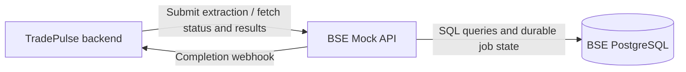

# TradePulse BSE Mock API

TradePulse BSE Mock API is a standalone external data-provider service for
TradePulse. It simulates a BSE-style trade extraction API with deterministic
synthetic data, PostgreSQL persistence, asynchronous extraction jobs, and
optional completion webhooks.

> **Main TradePulse application:** [devops-victim/tradepulse](https://github.com/devops-victim/tradepulse)

This service is deliberately separate from the TradePulse application so that
TradePulse integrates with an independently running external provider rather
than reading its own database directly. That separation makes request
filtering, delays, asynchronous processing, result retrieval, callback
delivery, and failure handling testable as an external API boundary.

## Architecture



## Implemented capabilities

- 10,000 deterministic synthetic trade records can be seeded.
- Trade listing, symbol listing, statistics, and single-trade lookup.
- Inclusive symbol and timestamp filtering with cursor pagination.
- Asynchronous extraction jobs with `pending`, `processing`, `completed`, and
  `failed` states.
- Configurable extraction delays from `0` through `900000` milliseconds
  (15 minutes).
- Extraction results are copied into a durable snapshot before the `202`
  response and can be paginated after completion.
- Optional callback registration using an exact URL allowlist, shared bearer
  secret, client job UUID, and idempotency key support.
- Durable webhook outbox with bounded retries, recovery after restart, and
  explicit redelivery.
- Health checks and PostgreSQL-backed readiness checks.

All trades are fictional. Prices are synthetic INR scenario values, not live
market quotes.

## Technology stack

- Node.js 22 or newer
- Express 5
- PostgreSQL
- `pg` connection pooling
- CommonJS JavaScript
- Node's built-in test runner

## Extraction lifecycle

1. TradePulse submits `POST /extractions` with optional filters and delay.
2. The BSE API creates a durable extraction job and copies matching trades into
   `extraction_results` in the same database transaction.
3. The job is acknowledged immediately with HTTP `202`; the worker waits until
   its persisted `ready_at` time. The HTTP submission connection is not held.
4. At the scheduled time, the worker marks the job `completed` (or `failed` if
   processing cannot be persisted successfully).
5. If a callback was registered, the BSE API creates a durable outbox event and
   sends a completion or failure webhook.
6. TradePulse fetches the completed result pages from `resultsUrl`, correlates
   the job using its IDs, and performs ingestion.

The extraction result snapshot is immutable: later changes to `trades` do not
change an already-created extraction.

## Repository structure

```text
.
├── migrations/
│   ├── 001_initial.sql
│   └── 002_callbacks_and_idempotency.sql
├── scripts/
│   ├── create-db.js
│   ├── migrate.js
│   └── seed.js
├── src/
│   ├── controllers/index.js
│   ├── db/index.js
│   ├── db/transaction.js
│   ├── routes/index.js
│   ├── services/
│   │   ├── extractions.js
│   │   ├── outbox.js
│   │   ├── trades.js
│   │   └── webhook-http.js
│   ├── app.js
│   ├── config.js
│   ├── errors.js
│   ├── server.js
│   ├── validation.js
│   └── webhook-validation.js
├── tests/
├── .env.example
├── db.js
├── package.json
└── package-lock.json
```

`db.js` is a compatibility re-export of `src/db`.

## Prerequisites

- Node.js `22+` (the package declares `engines.node >=22`)
- npm
- PostgreSQL
- A PostgreSQL role that can create the `bse_trades` database when using
  `npm run db:create`, or an already provisioned database and a valid
  `DATABASE_URL`

## Local setup

From PowerShell:

```powershell
git clone https://github.com/devops-victim/tradepulse-database.git
Set-Location .\tradepulse-database
npm install
Copy-Item .env.example .env
```

Edit `.env` and set at least `DATABASE_URL`. For a local PostgreSQL instance,
the example uses a database named `bse_trades`:

```dotenv
PORT=4001
DATABASE_URL=postgresql://localhost:5432/bse_trades
NODE_ENV=development
```

If your PostgreSQL installation requires credentials, add them to the URL locally. Do not commit `.env`, passwords, webhook secrets, or callback tokens.

Create the database, apply migrations, seed the 10,000 trades, and start the
service:

```powershell
npm run db:create
npm run migrate
npm run seed
npm start
```

`npm run db:create` connects to the `postgres` database and creates
`bse_trades`; it requires the PostgreSQL role to have `CREATEDB`. If the
database already exists, or if using a managed PostgreSQL database, skip this
command. `npm run migrate` applies numbered SQL files transactionally and
records checksums in `schema_migrations`. `npm run seed` inserts deterministic
IDs `BSE-TRD-000001` through `BSE-TRD-010000` in 500-row batches and does not
duplicate IDs when rerun.

Verify that the service is reachable:

```powershell
Invoke-RestMethod http://localhost:4001/health
# Or, if curl is preferred on Windows:
curl.exe http://localhost:4001/health
```

When healthy, the response has `success: true`, `api: "healthy"`,
`database: "healthy"`, and `extractionWorker: "healthy"`.

Useful package scripts:

| Command | Purpose |
| --- | --- |
| `npm start` | Start the API |
| `npm run dev` | Start with Node watch mode |
| `npm run db:create` | Create `bse_trades` from an existing PostgreSQL database |
| `npm run migrate` | Apply checked migrations |
| `npm run seed` | Seed deterministic mock trades |
| `npm test` | Run the Node test suite |
| `npm run test:integration` | Run PostgreSQL integration tests when a database URL is configured |
| `npm run test:webhooks` | Run webhook validation and delivery tests when configured |

## Environment variables

Values below are parsed and range-checked by `src/config.js`.

| Variable | Default | Description |
| --- | --- | --- |
| `PORT` | `4001` | HTTP listening port, 1–65535 |
| `DATABASE_URL` | required | PostgreSQL connection URL |
| `NODE_ENV` | unset | Set to `production` to require HTTPS callback URLs |
| `DEFAULT_DELAY_MS` | `0` | Default delay for `GET /getTrades` |
| `MAX_DELAY_MS` | `900000` | Maximum accepted delay, 0–900000 ms |
| `DEFAULT_EXTRACTION_DELAY_MS` | `0` | Default delay for `POST /extractions` |
| `CORS_ORIGINS` | empty | Comma-separated allowed origins; `*` allows all |
| `PG_POOL_MAX` | `10` | PostgreSQL pool size, 2–100 |
| `PG_SSL` | unset | Set to `true` for verified TLS using the platform CA store |
| `PG_SSL_CA_FILE` | unset | Optional PEM CA file for PostgreSQL TLS |
| `SEED_REFERENCE_TIME` | first seed time | ISO timestamp used as the deterministic seed reference |
| `BSE_WEBHOOK_SECRET` | empty | Shared bearer secret; required for callback registration and administration, 32–512 printable non-space ASCII characters |
| `BSE_CALLBACK_ALLOWLIST` | local URL in development; empty in production | Comma-separated exact callback URLs |
| `BSE_WEBHOOK_TIMEOUT_MS` | `10000` | Whole webhook exchange timeout, 100–25000 ms |
| `BSE_WEBHOOK_MAX_ATTEMPTS` | `6` | Attempts per delivery cycle, 1–20 |
| `BSE_WEBHOOK_RETRY_BASE_MS` | `1000` | Initial retry backoff |
| `BSE_WEBHOOK_RETRY_MAX_MS` | `300000` | Maximum retry backoff |

The development callback default is
`http://localhost:4000/api/bse/notifications`. Production has no implicit
allowlist and requires HTTPS destinations. Generate a secret locally instead
of copying one from any environment:

```powershell
node -e "console.log(require('crypto').randomBytes(32).toString('hex'))"
```

## API reference

Unless noted otherwise, successful responses are JSON. Unknown query/body
properties are rejected. Request bodies are limited to 16 KB.

| Method | Route | Purpose |
| --- | --- | --- |
| `GET` | `/health` | API, database, and worker readiness |
| `GET` | `/getTrades` | Live, filtered, cursor-paginated trades |
| `GET` | `/trades/:tradeId` | One trade |
| `GET` | `/symbols` | Sorted distinct symbols |
| `GET` | `/stats` | Trade, symbol, and client counts |
| `POST` | `/extractions` | Create an asynchronous extraction |
| `GET` | `/extractions/:jobId` | Read job status and metadata |
| `GET` | `/extractions/:jobId/results` | Read completed extraction pages |
| `GET` | `/extractions/:jobId/notification` | Read callback delivery state |
| `POST` | `/extractions/:jobId/notification/redeliver` | Start a new callback retry cycle |

The two notification routes require an `Authorization` header containing the configured bearer secret. Trade and extraction submission routes do not require authentication in this application.

### Trade listing

`GET /getTrades` accepts:

| Parameter | Rules |
| --- | --- |
| `symbol` | Optional uppercase symbol, 1–20 characters |
| `from`, `to` | Optional ISO 8601 timestamps with timezone; inclusive |
| `limit` | Optional integer 1–1000; default `100` |
| `cursor` | Opaque cursor returned for the same filter scope |
| `delay` | Optional integer 0–`MAX_DELAY_MS` |

Results are ordered by `timestamp DESC, trade_id DESC`:

```json
{
  "success": true,
  "count": 1,
  "nextCursor": null,
  "data": [{
    "trade_id": "BSE-TRD-000001",
    "client": "CLIENT-001",
    "symbol": "TCS",
    "quantity": 150,
    "price": "3245.50",
    "timestamp": "2026-10-12T10:30:00.123456Z"
  }]
}
```

`price` is returned by PostgreSQL as a numeric string and timestamps preserve
microseconds. `/symbols` returns `{ "success": true, "data": ["BHARTIARTL", ...] }`.
`/stats` returns:

```json
{"success":true,"data":{"total_trades":10000,"total_symbols":10,"total_clients":100}}
```

### Asynchronous extractions

`POST /extractions` accepts JSON:

```json
{
  "symbol": "TCS",
  "from": "2026-10-01T00:00:00Z",
  "to": "2026-10-13T23:59:59Z",
  "delay": 5000
}
```

`symbol`, `from`, `to`, and `delay` are optional. Pagination parameters are
not accepted. The response is immediate and has status `202`:

```json
{
  "success": true,
  "jobId": "26cdac89-4afb-4b26-a433-d69a4c870adb",
  "status": "pending",
  "statusUrl": "/extractions/26cdac89-4afb-4b26-a433-d69a4c870adb",
  "resultsUrl": "/extractions/26cdac89-4afb-4b26-a433-d69a4c870adb/results"
}
```

`GET /extractions/:jobId` returns `job_id`, `status`, `filters`, `delay_ms`,
`ready_at`, `total_records`, `error`, `created_at`, `started_at`, and
`completed_at`. Before completion, results return `409` with error code
`EXTRACTION_NOT_READY`; failed jobs return `409` with
`EXTRACTION_FAILED`. Completed results use the same `count`, `nextCursor`,
and `data` shape as live trade pages and accept only `limit` and `cursor`.

### PowerShell examples

Create an extraction:

```powershell
$body = @{ symbol = "TCS"; delay = 5000 } | ConvertTo-Json
$job = Invoke-RestMethod `
  -Method Post `
  -Uri "http://localhost:4001/extractions" `
  -ContentType "application/json" `
  -Body $body
$job
```

Check extraction status:

```powershell
Invoke-RestMethod "http://localhost:4001$($job.statusUrl)"
```

Retrieve completed results:

```powershell
Invoke-RestMethod "http://localhost:4001$($job.resultsUrl)?limit=100"
```

Test the maximum 15-minute extraction delay (the request returns `202`
immediately; wait until `ready_at` before retrieving results):

```powershell
$longBody = @{ symbol = "TCS"; delay = 900000 } | ConvertTo-Json
$longJob = Invoke-RestMethod `
  -Method Post `
  -Uri "http://localhost:4001/extractions" `
  -ContentType "application/json" `
  -Body $longBody
$longJob
Invoke-RestMethod "http://localhost:4001$($longJob.statusUrl)"
```

## Webhook notifications

Register a callback by supplying **both** `callbackUrl` and `clientJobId` in
the extraction body. `clientJobId` must be a UUID. Registration is rejected
unless `BSE_WEBHOOK_SECRET` is configured and the URL exactly matches an
allowlisted scheme, origin, and path. Credentials, query strings, fragments,
wildcards, and (in production) HTTP URLs are not allowed.

An `Idempotency-Key` request header is optional. It may contain 1–200 letters,
digits, dots, underscores, colons, or hyphens. Reusing it with an equivalent
request returns the original job; reusing it with a different request returns
`409 IDEMPOTENCY_CONFLICT`.

Example registration (replace all placeholder IDs and URLs):

```powershell
$body = @{
  symbol = "TCS"
  delay = 5000
  clientJobId = "c6f6d735-52be-4e67-ae19-c5b7d968c2f0"
  callbackUrl = "http://localhost:4000/api/bse/notifications"
} | ConvertTo-Json
Invoke-RestMethod -Method Post `
  -Uri "http://localhost:4001/extractions" `
  -Headers @{ "Idempotency-Key" = "tradepulse-request-1" } `
  -ContentType "application/json" -Body $body
```

After the terminal job transaction commits, the BSE API sends:

```json
{
  "externalJobId": "26cdac89-4afb-4b26-a433-d69a4c870adb",
  "clientJobId": "c6f6d735-52be-4e67-ae19-c5b7d968c2f0",
  "status": "completed"
}
```

Failed jobs use the same shape with `"status": "failed"`. The request uses `Content-Type: application/json` and the configured bearer authorization. A 2xx response acknowledges delivery.
Redirects are not followed. Network failures, timeouts, disconnects, HTTP 429,
and HTTP 5xx responses retry with bounded exponential backoff; `Retry-After`
can increase the delay up to the configured cap. Other non-2xx responses are
permanent failures. Delivery is at least once, so receivers should deduplicate
by job/status.

Delivery states are `pending`, `delivering`, `retry`, `delivered`,
`permanent_failure`, and `exhausted`. The notification status route exposes
attempt counts, next attempt time, last error code, and last HTTP status.
`POST /extractions/:jobId/notification/redeliver` resets a delivered,
permanent, or exhausted event to a fresh retry cycle and returns `202`.

## PostgreSQL schema and seeding

Migration `001_initial.sql` creates:

- `trades`: trade ID, client, symbol, quantity, price, timestamp, and
  `created_at`, with positive-value checks and indexes for timestamp, symbol,
  and client access.
- `extraction_jobs`: job state, filters, delay, schedule, counts, and error
  timestamps.
- `extraction_results`: per-job immutable trade snapshots.

Migration `002_callbacks_and_idempotency.sql` adds callback registration and
idempotency fields to `extraction_jobs` and creates `extraction_outbox` for
durable notification delivery.

The seed script uses ten symbols (`RELIANCE`, `TCS`, `INFY`, `HDFCBANK`,
`ICICIBANK`, `SBIN`, `ITC`, `WIPRO`, `LT`, and `BHARTIARTL`), 100 fictional
clients, quantities from 1 to 5000, and prices derived from deterministic
scenario values. It stores the first reference time in `seed_metadata`, so
rerunning the seed is repeatable and inserts no duplicate seed IDs.

## Reliability, error handling, and limitations

- PostgreSQL statements have a 20-second timeout; the pool connection timeout
  is 5 seconds.
- A schema advisory lock permits only one extraction worker per database
  schema. Run one service replica per schema.
- On startup, the worker recovers pending/processing jobs and unfinished
  webhook outbox entries from durable timestamps. There is no cron, periodic
  scan, or polling loop.
- Graceful shutdown cancels timers and active deliveries while preserving
  durable state. A worker/database failure causes the process to stop so a
  process manager can restart it.
- Successful extraction submission is durable before the `202` response.
- Validation errors use HTTP `400`; missing jobs/trades use `404`; results that
  are not ready or failed use `409`; unavailable dependencies use `503`.
- Generic unexpected request failures return `503`; invalid JSON returns
  `400`, and bodies over 16 KB return `413`.
- There is no automatic cleanup or retention scheduler for jobs, snapshots,
  or metadata.
- Trade and extraction submission endpoints have no authentication in this
  service. Protect the deployment with the surrounding platform if required.
- Synchronous trade-list delays can be as long as 15 minutes, but client and
  proxy timeouts may be shorter. Asynchronous extraction is the intended
  mechanism for long-running work.

## Render deployment

The project context identifies these deployed services:

- BSE API: [tradepulse-bse-api.onrender.com](https://tradepulse-bse-api.onrender.com)
- TradePulse backend: [tradepulse-gok9.onrender.com](https://tradepulse-gok9.onrender.com)

The repository does not contain a Render blueprint or deployment file, so
production Render settings must be configured in the Render dashboard or
external infrastructure. Configure `DATABASE_URL`, `NODE_ENV=production`,
`BSE_WEBHOOK_SECRET`, and an HTTPS `BSE_CALLBACK_ALLOWLIST` there; never place
secrets in this README or source control.

Render free-tier availability, sleeping/cold-start behavior, outbound
networking, PostgreSQL limits, and the current status of the supplied URLs
are deployment-dependent and should be confirmed in Render before relying on
them for academic demonstrations or long extraction delays. A sleeping
service can make health checks and webhook timing appear slower than local
execution.
